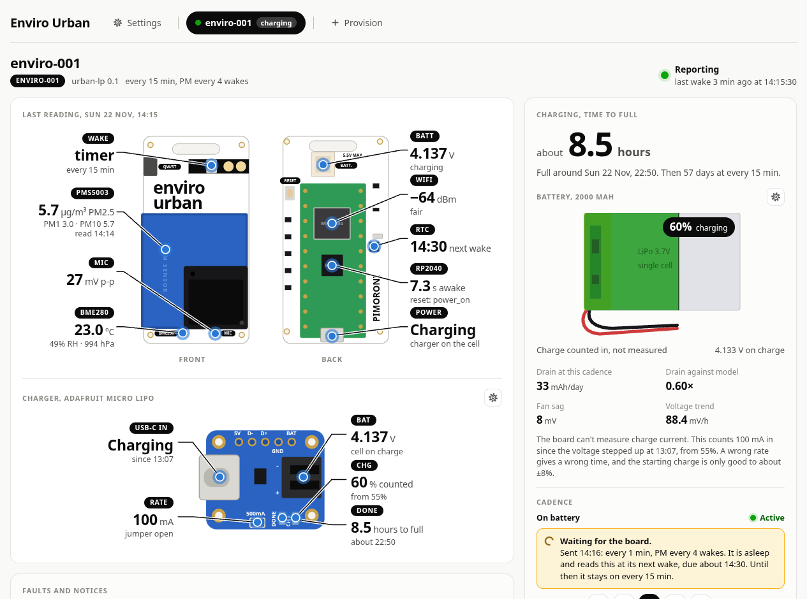
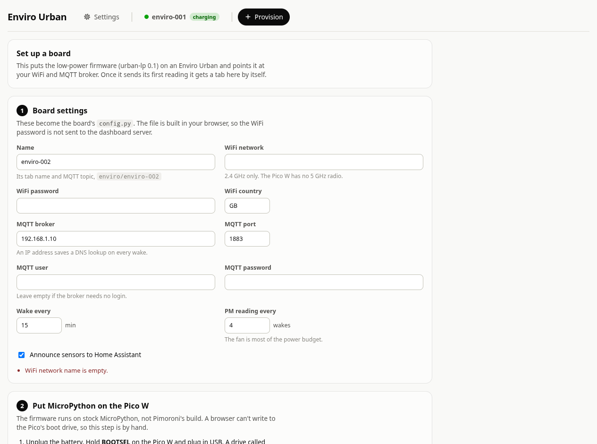

# Enviro Urban, low power

Replacement firmware for the Pimoroni [Enviro Urban](https://shop.pimoroni.com/products/enviro-urban) that stops it flattening its batteries, and a dashboard that shows each board's readings and works out how long its battery will last.



There are two parts, and you can use either without the other.

- **`firmware/`** is MicroPython for the board. Each wake it reads the sensors, sends one MQTT message and cuts its own power.
- **The dashboard** is one container. It logs those MQTT messages, serves the page above, sends cadence changes back to the boards and sets up new ones.

## What was wrong with the stock firmware

Short version: the hardware is sound and the stock firmware hangs with the power latch held on. A hung board draws tens of mA instead of a few µA, so a set of batteries lasts days.

The evidence is in Pimoroni's own issue tracker:

- In [enviro#87](https://github.com/pimoroni/enviro/issues/87), sjefferson99 put a meter on a hung board. The latch pin (GP2) sat at 3.3 V with the rails up. Shorting `3V3_EN` to ground shut the board down, and "the RTC woke it up shortly after". The latch and the RTC both worked. The CPU was stuck.
- [enviro#210](https://github.com/pimoroni/enviro/issues/210) blames the board thinking it is on USB. The log line behind that, `on usb power (so can't shutdown)`, is printed after every shutdown with no check at all (`sleep()` in `enviro/__init__.py`). On battery it still gets written, because the supply takes a few milliseconds to collapse.
- The stock repo's main branch has had no commits since April 2024.

What this firmware does about it:

| Stock firmware | This firmware |
|---|---|
| A hang leaves the latch held, and nothing recovers it. | An 8 second hardware watchdog resets the chip. A reset releases the latch, so a hang ends in power off. |
| The next wake depends on software re-arming an RTC alarm against a wall clock that sometimes reset to the year 2000. | The RTC countdown timer reloads itself in hardware. The board wakes again even if the last run crashed. No clock or NTP is needed. |
| Battery monitoring was switched off in [v0.0.9](https://github.com/pimoroni/enviro/releases/tag/v0.0.9), because reading the battery pin while WiFi runs upset the WiFi chip. | The battery is read before the WiFi chip is powered in that wake, and again under fan load. |
| A crash leaves no trace. | A marker in the RTC's spare RAM byte records the stage each wake reached. The next message carries `last_fault: wifi`, or whichever stage it died in. |
| Particulate readings are unstable ([enviro#172](https://github.com/pimoroni/enviro/issues/172)). | The fan runs for 30 seconds first. Frames are checksum-checked and three are averaged. |
| Needs Pimoroni's custom MicroPython build. | Runs on stock MicroPython for the Pico W. |

It also adds remote config over MQTT, Home Assistant discovery, a hardware self-test and a maintenance mode. [firmware/README.md](firmware/README.md) has the full reasoning, the power budget and a battery soak test.

**What it drops.** This is a different firmware, not a patch. There is no web provisioning on the board, no local CSV logging, no InfluxDB or Adafruit IO upload, and no support for the other Enviro boards (Indoor, Weather, Grow). It sends MQTT and nothing else.

## What has been tested

I'd rather you knew this before trusting it with a field deployment.

- The firmware has run on one Enviro Urban, for about a day so far, on a 2000 mAh LiPo. It logged one missed wake and one WiFi timeout that the next wake reported and recovered from. That is not a long soak.
- The dashboard's estimates come from that one board. Over 15 hours on battery it drew about 0.6 times the firmware README's power budget: roughly 107 mAh a day at 5 minute wakes and 33 mAh a day at 15 minute wakes, both with a particulate reading every fourth wake.
- **Installing from the browser (the Provision tab's "Connect and install") has not been run against a real board.** The manual install it also offers is the route that has been used.
- Charge detection has seen one real charge. It caught the start, and that charge exposed a bug (a single stray low reading ended it early) which is now fixed and tested.

## Quick start

You need a machine that runs Docker, and an MQTT broker the boards can reach, such as Mosquitto.

```bash
git clone https://github.com/Tombo1001/enviro-urban-lowpower.git
cd enviro-urban-lowpower
cp .env.example .env        # put your broker's address and login in here
docker compose up -d
```

Open `http://<that machine>:8870`. With no boards yet you land on the Provision tab.

`docker compose up -d` pulls the published image. Add `--build` to build it from the source instead.

| Variable | Default | What it does |
|---|---|---|
| `MQTT_HOST` | none | Broker address. Nothing is logged until this is set. |
| `MQTT_PORT` | `1883` | |
| `MQTT_USER`, `MQTT_PASSWORD` | empty | Broker login. |
| `MQTT_TOPIC` | `enviro/#` | Topic filter to log. Each board publishes under `enviro/<its name>/`. |
| `MQTT_SUBSCRIBE` | `1` | `0` makes the server read a log that something else writes. |
| `PHOTOS` | `on` | `off` skips the photo downloads. See [Pictures](#pictures). |
| `DATA_DIR` | `/data` | The message log, settings and fetched photos. Mount a volume here. |
| `PORT` | `8870` | |

**There is no login.** Anyone who can open the page can change a board's cadence and read its data. Keep it on a network you trust, or put it behind a reverse proxy that adds one.

## Using the dashboard

The tabs along the top are **Settings**, one tab per board, and **Provision**.

### Board tabs

A board gets a tab the first time one of its messages reaches the broker. Nothing needs adding by hand. The dot on a tab is green while the board reports on schedule and amber when a wake is overdue.

**The board diagram** shows the last reading on the part it came from: wake reason, particulates, noise, temperature, humidity and pressure on the front, and battery voltage, WiFi signal, next wake, time awake and power source on the back.

**The battery card** leads with the days left at the current cadence.

- Until the board has 20 readings over 2 hours on battery, it shows a range based on the power budget. After that it fits the real voltage drop and shows one figure with a range. The range is never tighter than ±25%, because voltage is the only fuel gauge.
- The battery picture fills red under 20%, amber under 50% and green above.
- The **cog on the battery** sets its capacity in mAh. Capacity changes the mAh figures, the estimate before a fit exists, and the charge time. Once the drain is fitted, days left come out the same whatever you enter, because the fit works in percent of charge per day.

**Cadence** has two halves.

- **On battery** is how often the board wakes and how often it runs the particulate sensor. Picking a chip only updates the estimate, so you can see what a setting would cost. **Send to board** makes it real. The board is asleep, so the page shows "Waiting for the board" until a wake reports the new cadence, and shows the error if the board rejects it.
- **On charge** switches the board to 1 or 5 minute wakes while a charge is detected and puts the old cadence back when it ends. "Active" means it is running now. "Standing by" means it is switched on and waiting for a charge. It runs in the server, so the page doesn't need to be open. It stops after 24 hours whatever happens.

"PM off" is there to estimate with. To switch the particulate sensor off for real, set `PM_MIN_V = 99` in the board's `config.py`.

**The charger diagram** is grey until a charge is detected. Then it shows the charge counted in and the time to full. The **cog on the charger** sets its rate, 100 or 500 mA.

**Faults and notices** lists everything the firmware flags: a wake that died and at which stage, exceptions, an RTC that lost power, a latch that didn't release, config changes applied or rejected, and wakes that never arrived.

**History** charts battery voltage, particulates, temperature, humidity, pressure, noise, WiFi signal and time awake. Hover for values. The last 40 wakes are also there as a table.

### Settings tab

- **Boards.** A display name, battery capacity and charger rate for each board.
- **Defaults for new boards.** Capacity and charger rate used until a board has its own.
- **MQTT.** Whether the server is connected to the broker and how many messages it has logged. The login comes from the environment, so it can't be changed here.
- **Pictures.** Which diagrams are photos and which are drawn.

### Provision tab

Sets up a new board in three steps.

1. **Board settings.** Name, WiFi and MQTT details. These become the board's `config.py`. The file is built in your browser, so the WiFi password never goes to the dashboard server.
2. **Put MicroPython on the Pico W.** By hand: hold BOOTSEL, plug in USB, and copy the UF2 onto the drive that appears. A browser can't write to that drive.
3. **Install the firmware.** "Connect and install" copies the drivers and your settings over USB, runs the hardware check and shows you its output. The firmware itself goes on last, once you have seen the result.



Step 3 uses Web Serial, which has two requirements.

- **Chrome or Edge on a desktop.** Firefox and Safari don't have it.
- **The page on HTTPS or on `localhost`.** Browsers switch USB serial off on plain HTTP. Either run the container on the computer the board is plugged into, or put HTTPS in front of it (`tailscale serve` does this in one command on a tailnet).

Without those, the tab offers the firmware as a zip and your `config.py` as a download, with `mpremote` instructions inside the zip.

To re-do a board that already runs this firmware, hold **STATUS** for 3 seconds while pressing **RESET**. The white LED stays on and the board waits with its watchdog off.

## Charging with an Adafruit Micro Lipo

Enviro boards can't charge a battery. Pimoroni's product page says so: "there's no battery charging included on Enviro boards, so you'll need a separate LiPo battery charger". Plugging USB into the Pico W powers the board and leaves the cell exactly where it was.

So a LiPo needs its own charger. The [Adafruit Micro Lipo](https://www.adafruit.com/product/4410) is a small one that suits this, and the dashboard's charger diagram is drawn for it.

**Wiring.** The charger goes on the cell in parallel with the board. The cell stays plugged into the Enviro's battery socket, and a second pair of leads runs from the cell to the charger's BAT connection. Check polarity before you plug anything in. JST-PH cells are not all wired the same way round, and a reversed one will destroy the charger or the board.

**Why wire it that way.** The board stays on battery throughout, so it keeps reading the cell's voltage as it climbs. That is the only reason the dashboard can see a charge at all. It gets no signal from the charger.

**Charge rate.** The Micro Lipo charges at 100 mA as shipped, and at 500 mA if you solder its jumper closed. Adafruit suggest 500 mA only for cells of 500 mAh or more. Tell the dashboard which you have with the cog on the charger diagram.

**What the dashboard does with it.**

- A charge starts when the cell voltage steps up. A step of 50 mV counts at once, and a smaller one needs two readings in a row.
- Voltage reads high during a charge, so it can't be used as a fuel gauge. The page counts charge in from the moment of the step, at the rate you set, and takes off what the board is using.
- A charge ends on two low readings in a row, or once the cell has passed 4.15 V and then settled 15 mV below its peak.

**Limits.** Time to full is a count, not a measurement. Set the wrong rate and the time is wrong. The starting charge is only good to about ±8%. I also haven't tested how the charger decides a cell is full while the board is waking every minute and drawing from the same cell.

Don't leave a charging LiPo unattended, and don't charge one that is swollen or damaged.

## How the battery estimate works

1. Each battery reading goes through a voltage-to-charge table to give the charge left. Readings taken on USB are left out.
2. Each wake gets a modelled cost: seconds awake at 70 mA, plus 30 seconds of fan at 150 mA on particulate wakes.
3. Charge left is fitted against the running total of modelled cost. The slope says how many times the real drain exceeds the model. Because the fit is against charge spent and not time, it holds across cadence changes.
4. Days left is the usable charge, down to 3.5 V, divided by the calibrated daily cost at the current cadence.

The voltage table and the two currents are at the top of [app/estimate.py](app/estimate.py). The table is a generic LiPo curve and the currents are estimates. A recorded full discharge would let you tune all three.

## Pictures

The product photos belong to Pimoroni, Adafruit and DNK Power, so none are in this repository. On first start the server downloads each one from its maker's site, crops it to fit the callouts and keeps it in the data folder. If a download fails, or you set `PHOTOS=off`, the page uses the drawn diagrams in `frontend/public/drawn` instead. The screenshots above show the drawn ones.

## Working on it

```bash
python3 app/test_estimate.py     # the estimator, on synthetic discharges and charges
python3 app/test_server.py       # settings, the on-charge automation, firmware hand-out

cd frontend
pnpm install
pnpm build                       # type-checks, then writes dist/
```

Run the server from the source with `MQTT_HOST=<broker> python3 app/server.py`. It serves `frontend/dist` and keeps its data in `./data`.

- `app/server.py` is the HTTP server and API. `app/mqtt.py` is a small MQTT client on the standard library. `app/estimate.py` holds the battery estimate, charge detection and fault list. Pillow, for the photos, is the only dependency.
- `frontend/` is Vue 3 and TypeScript with no chart library. The charts and diagrams are hand-built SVG.
- The log is one JSON object per line in `data/messages.jsonl`: `{"ts": "...Z", "topic": "...", "retained": false, "payload": {...}}`. Retained replays are kept in the file and left out of the metrics.

## Credits and licence

MIT. See [LICENSE](LICENSE).

- The firmware replaces [pimoroni/enviro](https://github.com/pimoroni/enviro) (MIT) and owes its understanding of the board to that project, its schematic and its issue threads.
- `firmware/lib/umqtt/simple.py` is from [micropython-lib](https://github.com/micropython/micropython-lib) (MIT).

This project isn't affiliated with Pimoroni or Adafruit.
